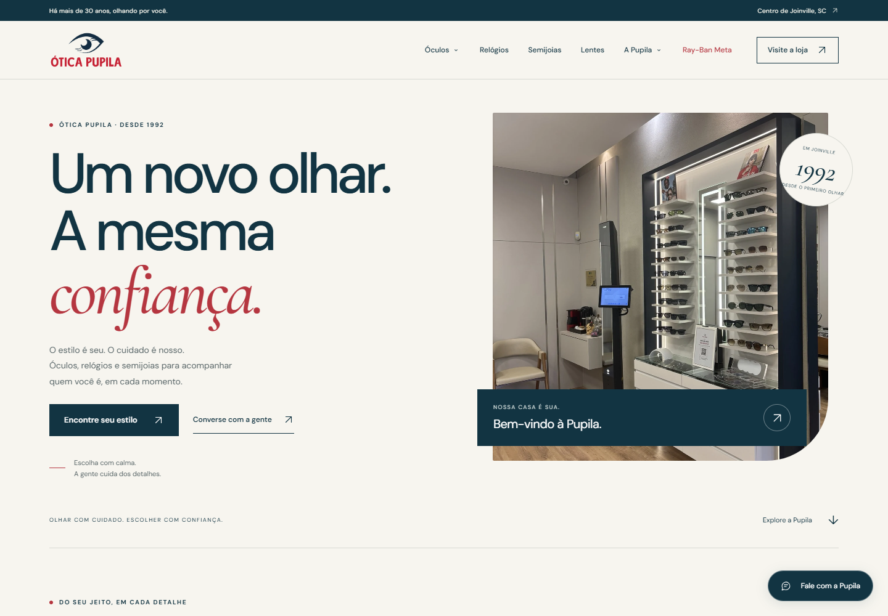
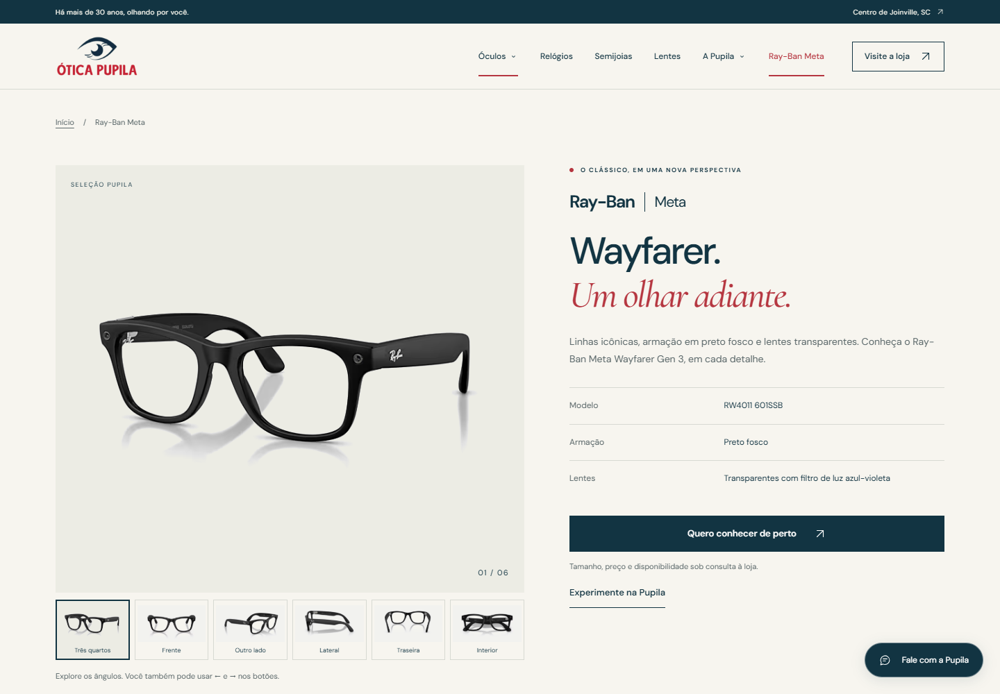

# Revisão de design e qualidade

Revisão de 27 de outubro de 2026, acompanhada pela Issue #5 e pelo PR #4.

## Resultado

- Home com títulos maiores, contraste entre tipografia sem serifa e serifada, paleta azul-marinho/vermelho, fundo claro e fotos da loja.
- Cabeçalho unificado, menu responsivo, categorias editoriais, destaque Ray-Ban Meta, história, lentes, depoimentos, perguntas frequentes e localização.
- Páginas de categorias, marcas, produto, lentes, história e contato com os mesmos estilos e componentes.
- Remoção de produtos fictícios, espaços reservados e filtros sem dados. Categorias direcionam para consulta da seleção real.
- Galeria de seis ângulos com botões, setas, Home/End, descrições e anúncio do contador. Trocas rápidas não dependem de callbacks de animação.
- Conteúdo separado de estilos e comportamento. Cabeçalho e rodapé definidos uma vez e compartilhados entre as páginas.
- Fontes locais compactadas e remoção de GSAP/CDN. O site carrega sem chamadas a terceiros.
- Contato por telefone disponível também quando JavaScript está desativado.

## Verificação

- `npm test`: passou; 14 rotas e 51 referências de imagens verificadas, além de links, âncoras, fontes, IDs e sintaxe.
- `node --check assets/pages.js` e `node --check assets/app.js`: passaram.
- `git diff --check`: passou.
- Playwright/Chromium: 56 cenários, cobrindo 14 rotas em 320, 390, 768 e 1440 px; sem rolagem horizontal, falha estrutural ou erro de JavaScript detectado.
- axe-core 4.10.3: 28 análises, cobrindo as 14 rotas em 390 e 1440 px, com WCAG A/AA, WCAG 2.1 AA e boas práticas; sem violações detectadas. A análise usa movimento reduzido para observar os estados finais dos elementos.
- 26 verificações de interação: skip link e foco; menu móvel, Escape e navegação; âncoras, voltar/avançar e restauração de rolagem; seis ângulos, setas, Home/End; mensagem e número do WhatsApp; FAQ pelo teclado; página 404; links diretos, recarga e movimento reduzido.
- Imagens da home carregadas e funcionamento com requisições externas bloqueadas.
- Telefone visível e utilizável no conteúdo alternativo sem JavaScript.
- Inspeção visual da home, destaque de produto, galeria e contato em desktop e celular.

Os testes automatizados e de teclado não substituem avaliação manual com leitores de tela ou testes em aparelhos físicos.

## Limitações mantidas explícitas

- Produtos individuais, preços e disponibilidade dependem de confirmação da loja.
- O site é estático, com navegação no hash; as páginas internas não possuem URLs independentes para indexação ou prévias sociais específicas.
- Os depoimentos e horários foram preservados da prévia, sem verificação comercial independente nesta revisão.
- Antes de publicar, é necessário completar as informações da hospedagem na política de privacidade.
- Nenhum deploy foi realizado nesta revisão.

## Prévia

